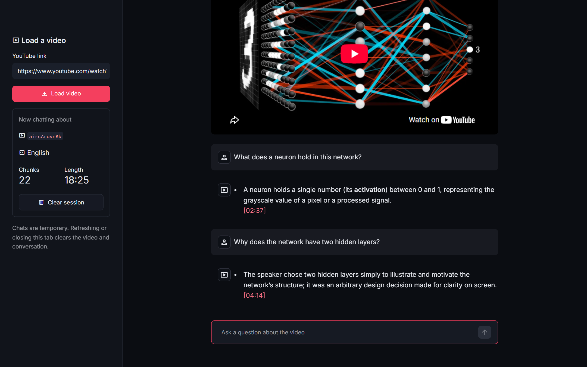
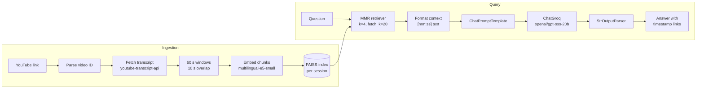
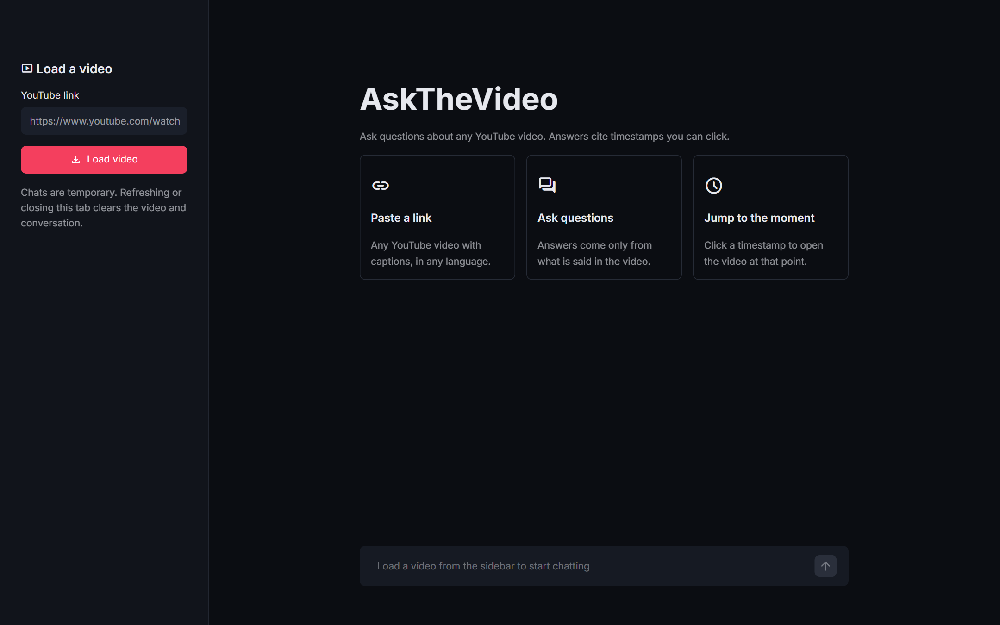

# AskTheVideo

Paste a YouTube link and ask questions about the video. Answers come only from the transcript and cite timestamps you can click.



## Features

- Accepts `youtube.com/watch`, `youtu.be`, `shorts`, `embed` and mobile links, or a bare 11 character video ID.
- Splits the transcript into 60 second windows with 10 seconds of overlap, so an idea that spans a boundary is still retrievable.
- Retrieves 4 transcript excerpts per question with Maximal Marginal Relevance (MMR), which avoids returning near duplicate windows.
- Works with captions in any language, using English captions when the video has them.
- Answers with Groq's `openai/gpt-oss-20b`, citing timestamps like `[04:32]`. Each citation links to that moment in the video.
- Replies "This isn't covered in the video." when the transcript does not contain the answer.
- Temporary chat: no database and no login. Each browser tab has its own index and chat, and a refresh clears it.

## Architecture



## Tech stack

| Layer | Choice |
|---|---|
| User interface | Streamlit |
| Transcript | youtube-transcript-api |
| Chunking | Custom 60 second windows with 10 second overlap, as LangChain `Document` objects |
| Embeddings | `intfloat/multilingual-e5-small` via `langchain-huggingface`, on CPU |
| Vector store | FAISS (`faiss-cpu`) via `langchain-community`, in memory |
| Retriever | MMR, `k=4`, `fetch_k=20` |
| LLM | Groq `openai/gpt-oss-20b` via `langchain-groq`, temperature 0 |
| Chain | LangChain Expression Language (LCEL) |
| Config | `python-dotenv` |
| Tests | pytest |

## Quick start (local)

Requires Python 3.12 (verified with 3.12.10).

```bash
git clone https://github.com/Vikram739/AskTheVideo.git
cd AskTheVideo
python -m venv .venv
```

Activate the virtual environment:

```bash
# macOS / Linux
source .venv/bin/activate
# Windows (PowerShell)
.venv\Scripts\Activate.ps1
```

Install dependencies and add your Groq API key:

```bash
pip install -r requirements.txt
cp .env.example .env    # Windows: copy .env.example .env
```

Open `.env`, set `GROQ_API_KEY`, then start the app:

```bash
streamlit run app.py
```

The app opens at http://localhost:8501.

## Quick start (Docker)

Create `.env` from `.env.example` as above, then run:

```bash
docker compose up --build
```

Open http://localhost:8501. The image installs the CPU build of PyTorch and includes the embedding model, so the first question does not wait for a download.

## Getting a free Groq API key

1. Sign in at [console.groq.com/keys](https://console.groq.com/keys).
2. Click "Create API Key" and copy the key.
3. Paste it into `.env` as `GROQ_API_KEY=...`.

## How it works

**Video ID parsing.** `askthevideo/youtube.py` reads the 11 character video ID from the link and rejects anything that is not a YouTube video link.

**Transcript fetch.** The app lists the video's captions with youtube-transcript-api and picks English when it exists, otherwise the first available language (manual captions before auto-generated ones). Results are cached by video ID as plain dicts, so two tabs loading the same video fetch it once. Errors such as disabled captions or a blocked network are shown as plain messages.

**Chunking.** `askthevideo/chunking.py` groups caption snippets into 60 second windows that start every 50 seconds. Each chunk keeps `video_id`, `start` and `end` (in seconds) as metadata.

**Indexing.** Chunks are embedded with `multilingual-e5-small` on CPU. It is a multilingual model, so an English question finds the right passage in a Hindi or Spanish transcript. Chunks are stored in an in-memory FAISS index that belongs to the current browser session. The embedding model is loaded once and shared by all sessions.

**Retrieval and answer.** For each question, the MMR retriever picks 4 excerpts from the 20 closest matches. They are sorted by time and formatted as `[mm:ss] text` (`[h:mm:ss]` past one hour), then sent to the Groq model with instructions to answer only from those excerpts and cite their timestamps.

**Timestamp links.** Every `[mm:ss]` or `[h:mm:ss]` in the answer becomes a link to `https://www.youtube.com/watch?v=<ID>&t=<seconds>s`.

## Configuration

| Variable | Required | Default | Description |
|---|---|---|---|
| `GROQ_API_KEY` | Yes | none | Groq API key from console.groq.com/keys |
| `GROQ_MODEL` | No | `openai/gpt-oss-20b` | Groq model used to answer questions |

## Running tests

```bash
pip install -r requirements-dev.txt
pytest
```

The tests make no network calls. The RAG test uses LangChain's deterministic fake embeddings and a fake chat model.

## Project structure

```
AskTheVideo/
├── app.py                  # Streamlit UI and session state
├── .streamlit/config.toml  # theme
├── askthevideo/
│   ├── config.py           # .env loading and settings
│   ├── youtube.py          # video ID parsing, transcript fetch, error messages
│   ├── chunking.py         # 60 second windows with overlap
│   ├── rag.py              # embeddings, FAISS, MMR retriever, prompt, chain
│   └── formatting.py       # timestamps, context formatting, timestamp links
├── tests/
├── assets/screenshots/
├── .env.example
├── requirements.txt
├── requirements-dev.txt
├── Dockerfile
└── docker-compose.yml
```

## Limitations

- Needs a video with captions (manual or auto-generated, any language). Videos with captions turned off can't be indexed.
- YouTube blocks transcript requests from most cloud provider IP addresses, so the project is built to run locally on a home network.
- The Groq free tier has rate limits. If you hit one, wait a minute and ask again.
- The first local run downloads the embedding model (about 470 MB).
- Indexing runs on CPU: a few seconds for a 20 minute video and about 25 seconds for a 2 hour video.
- Each question is answered on its own: there is no chat memory for follow-up questions.

## Screenshots

| Home | Chat |
|---|---|
|  |  |

## License

MIT. See [LICENSE](LICENSE).
